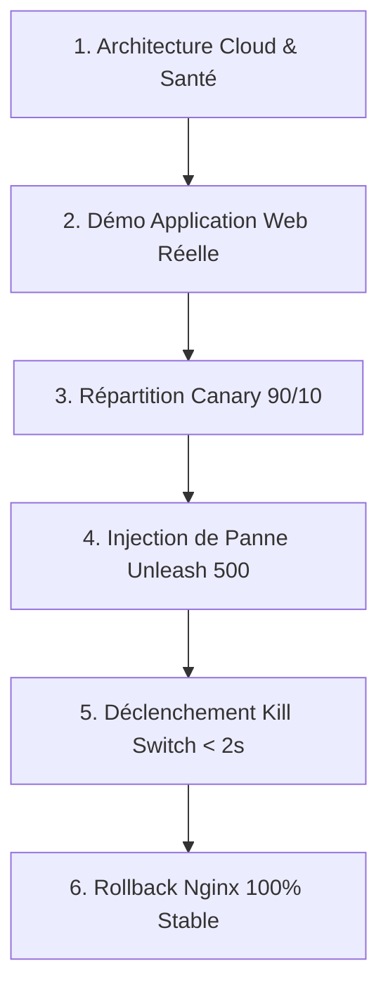

# 🎓 GUIDE DE DÉMONSTRATION EN DIRECT POUR LE PROFESSEUR
## Projet : CampusEnroll — Module DevOps, Qualité & Shift-Right Testing

> **Lien Cloud Public actif (accessible par le professeur depuis son PC ou mobile) :**  
> 🔗 [https://8080-cs-779849895818-default.cs-europe-west1-haha.cloudshell.dev/?authuser=0](https://8080-cs-779849895818-default.cs-europe-west1-haha.cloudshell.dev/?authuser=0)

---

## ⚡ 1. Préparation Ultra-Rapide (Avant que le professeur arrive)

Dans votre terminal **Google Cloud Shell** :

```bash
cd ~/app-etudiant
git pull
chmod +x shift-right/scripts/*.sh
```

Pour lancer toute la démonstration guidée pas-à-pas avec pauses interactives :
```bash
bash shift-right/scripts/interactive_demo.sh
```
> Le script marque une pause à chaque étape avec `Appuyez sur [ENTRÉE]...` afin que vous puissiez parler sereinement et commenter chaque action au professeur.

---

## ⏱️ 2. Déroulé Minute par Minute de la Présentation (5 à 7 min)



---

### 🕒 Minute 0:00 - 01:30 | Présentation de l'Architecture
**🗣️ Ce que vous dites au professeur :**
> *"Bonjour Monsieur. Pour notre projet CampusEnroll, nous avons mis en œuvre une approche Shift-Right Testing et Progressive Delivery conforme aux standards industriels actuels.*  
> *L'application est déployée en conteneurs Docker orchestrés derrière un routeur Nginx qui gère le trafic Canary (90% en version 1 stable, 10% en version 2 canary) couplé à un serveur de Feature Flags Unleash pour le Chaos Engineering et le Kill Switch instantané."*

**💻 Ce que vous montrez :**
Appuyez sur `[ENTRÉE]` sur l'**Étape 1** du script ou tapez :
```bash
docker ps --format "table {{.Names}}\t{{.Status}}\t{{.Ports}}"
```
👉 Montrez au professeur les **6 conteneurs actifs** :
1. `campus-canary-router` (Nginx avec module split_clients)
2. `campus-app-stable-v1` (Backend Node.js / Express version Stable)
3. `campus-app-canary-v2` (Backend Node.js / Express version Canary)
4. `campus-unleash-server` (Serveur Unleash de Feature Management)
5. `campus-mysql` (Base relationnelle de l'application)
6. `campus-unleash-db` (PostgreSQL dédié à Unleash)

---

### 🕒 Minute 01:30 - 02:30 | Démonstration sur le Navigateur Web
**🗣️ Ce que vous dites au professeur :**
> *"Voici l'application en ligne accessible publiquement. Vous pouvez vous-même ouvrir ce lien sur votre navigateur."*

**💻 Ce que vous montrez :**
1. Ouvrez l'URL :  
   `https://8080-cs-779849895818-default.cs-europe-west1-haha.cloudshell.dev/?authuser=0`
2. Ouvrez l'inspecteur du navigateur (`F12` -> onglet **Réseau** / **Network**).
3. Cliquez sur l'onglet **Inscriptions / Étudiants** ou simulez une transaction de paiement.
4. Montrez dans les en-têtes HTTP de la réponse :
   - `X-Canary-Pool : backend_stable` (ou `backend_canary`)
   - `X-Shift-Right-Router : Nginx-Canary-v1`
👉 **Point fort :** Cela prouve au professeur que le routage intelligent en amont fonctionne en production réelle.

---

### 🕒 Minute 02:30 - 03:45 | Test de Répartition Canary (90% / 10%)
**🗣️ Ce que vous dites au professeur :**
> *"Plutôt que de faire un déploiement Big Bang risqué, nous acheminons 10% des utilisateurs réels vers la version Canary v2 et 90% vers la version v1. Voici un tir de 20 requêtes en direct."*

**💻 Ce que vous montrez :**
Appuyez sur `[ENTRÉE]` sur l'**Étape 2** du script :
- Le terminal affiche en direct les requêtes avec les étiquettes :
  - `[STABLE  v1]` en bleu (~90%)
  - `[CANARY  v2]` en jaune (~10%)
- Toutes les requêtes répondent en **200 OK**.
- Le bilan statistique en fin de tir affiche le pourcentage effectif et 0% d'erreur.

---

### 🕒 Minute 03:45 - 05:00 | Injection de Panne (Chaos Testing avec Unleash)
**🗣️ Ce que vous dites au professeur :**
> *"Imaginons qu'un bug critique ou une panne de notre prestataire bancaire survienne sur la passerelle de paiement en production. Grâce à notre serveur de Feature Flags Unleash, nous simulons cette défaillance en activant le flag 'chaos_faulty_payment' sans modifier ni redéployer le code."*

**💻 Ce que vous montrez :**
Appuyez sur `[ENTRÉE]` sur l'**Étape 3** du script :
1. Le script active le flag dans Unleash en direct via l'API Admin.
2. Le simulateur envoie 20 requêtes :
   - Les requêtes échouent avec le statut rouge `500 ERR | GATEWAY_FAILURE`.
   - Le script déclenche automatiquement l'alerte :  
     `⚠️ ALERTE PANNE DÉTECTÉE : Taux d'erreur élevé !`
3. Si le professeur recharge la page web ou effectue un paiement, il constate immédiatement l'erreur applicative sécurisée.

---

### 🕒 Minute 05:00 - 06:00 | Déclenchement du Kill Switch (< 2 secondes)
**🗣️ Ce que vous dites au professeur :**
> *"En production traditionnelle, corriger cela prendrait 30 minutes : créer un hotfix, lancer le pipeline CI/CD, reconstruire l'image Docker et redéployer.  
> Avec notre stratégie Shift-Right, nous déclenchons notre Kill Switch Unleash. Le RTO (Recovery Time Objective) est inférieur à 2 secondes et sans aucun downtime."*

**💻 Ce que vous montrez :**
Appuyez sur `[ENTRÉE]` sur l'**Étape 4** du script :
1. Le script envoie l'ordre `production/off` à Unleash.
2. Les 20 requêtes suivantes repassent immédiatement au vert `200 OK | Transaction validée`.
3. Taux d'erreur retombé à **0.0%**.
👉 **Impact garanti sur le jury :** Rétablissement instantané sans redémarrage de conteneur.

---

### 🕒 Minute 06:00 - 07:00 | Canary Rollback Nginx (Isolation d'urgence de la V2)
**🗣️ Ce que vous dites au professeur :**
> *"Si le bug provenait directement du code de la nouvelle version Canary v2, notre deuxième ligne de défense est le Rollback au niveau de Nginx : nous reconfigurons le routeur pour isoler la v2 et envoyer 100% du trafic sur la v1 stable via un graceful reload sans interruption de session."*

**💻 Ce que vous montrez :**
Appuyez sur `[ENTRÉE]` sur l'**Étape 5** du script :
1. Nginx bascule sur `nginx-rollback.conf`.
2. Exécution de `docker exec campus-canary-router nginx -s reload`.
3. Statut Nginx :  
   `"state": "ROLLED_BACK", "ratio": "100% Stable / 0% Canary"`
4. Le simulateur démontre que 100% des requêtes vont désormais exclusivement sur `[STABLE v1]`.

---

## 🛠️ 3. Commandes Individuelles « Coup de Poing » (Si le prof demande une action précise)

| Ce que le prof vous demande | Commande exacte à copier/coller dans Cloud Shell |
| :--- | :--- |
| **Vérifier l'état de Nginx** | `curl -s http://localhost:8080/canary-status` |
| **Lancer un tir de 30 requêtes** | `bash shift-right/scripts/simulate_traffic.sh` |
| **Activer la panne à la main** | `bash shift-right/scripts/unleash_toggle_flag.sh on` |
| **Couper la panne (Kill Switch)** | `bash shift-right/scripts/unleash_toggle_flag.sh off` |
| **Faire le Rollback Nginx (100% Stable)** | `bash shift-right/scripts/canary_rollback.sh` |
| **Réactiver le Canary (90% / 10%)** | `bash shift-right/scripts/canary_promote.sh` |
| **Consulter les logs Nginx en direct** | `docker logs -f campus-canary-router` |

---

## 🎯 4. Questions Fréquentes du Professeur & Réponses Types

### Q1 : *"Pourquoi tester en production (Shift-Right) plutôt que seulement en local (Shift-Left) ?"*
> **Réponse :**  
> *"Le Shift-Left (tests unitaires, E2E avec Playwright) permet de vérifier la conformité fonctionnelle avant mise en ligne. Mais il ne permet pas d'observer les comportements réels sous charge, les pannes réseau des passerelles tierces et les conditions imprévues des utilisateurs. Le Shift-Right permet de tester avec du vrai trafic tout en limitant le rayon d'impact (Blast Radius) à 10% des utilisateurs grâce au Canary Release."*

### Q2 : *"Comment garantissez-vous qu'un utilisateur ne saute pas de la V1 à la V2 au milieu de sa navigation ?"*
> **Réponse :**  
> *"Dans notre configuration Nginx, nous utilisons la directive `split_clients` basée sur le hachage de l'adresse IP et du User-Agent client (`${remote_addr}${http_user_agent}`). Ainsi, la répartition reste cohérente (sticky session) pour chaque utilisateur tout au long de sa session."*

### Q3 : *"Quel est l'avantage d'Unleash par rapport à une simple variable d'environnement ?"*
> **Réponse :**  
> *"Une variable d'environnement nécessite un redémarrage du conteneur Docker (ou un rolling update de pods), ce qui entraîne plusieurs dizaines de secondes d'attente et un risque d'interruption. Unleash communique via un SDK client avec rafraîchissement dynamique en mémoire : la modification est active en moins d'une seconde sans aucun redémarrage."*
